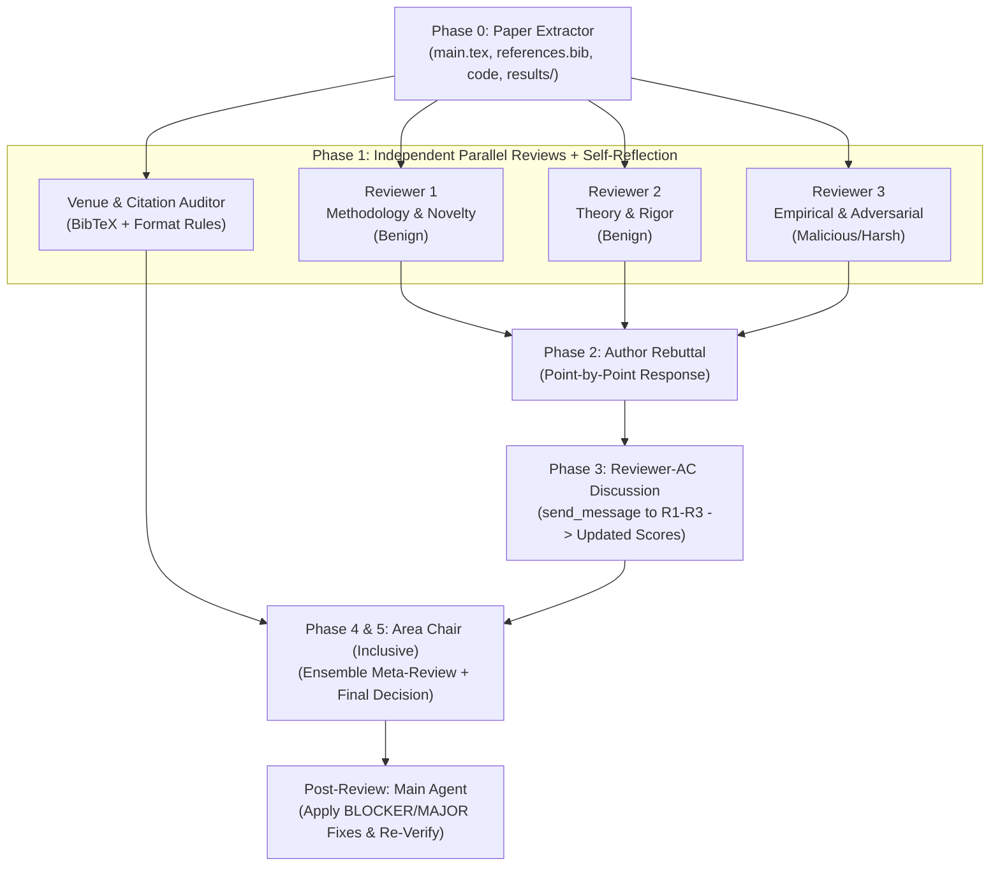

<h1 align="center">
  <b>Paper Reviewer</b><br>
  <b>Multi-Agent Academic Peer Review for ML/AI Manuscripts</b>
</h1>

<p align="center">
  <em>Zero-dependency <code>SKILL.md</code> unifying NeurIPS-grade rubric evaluation, adversarial empirical auditing, author rebuttal, and Area Chair meta-review via strictly isolated subagents.</em>
</p>

<p align="center">
  <a href="https://skills.sh/Vanszs/paper-reviewer/paper-reviewer"></a>
  
  
  
  
</p>

<p align="center">
  <a href="SKILL.md">[SKILL.md]</a> |
  <a href="https://skills.sh/Vanszs/paper-reviewer/paper-reviewer">[skills.sh]</a> |
  <a href="#quickstart">[Quickstart]</a> |
  <a href="#acknowledgements--citations">[Acknowledgements]</a>
</p>

---

## Table of Contents

1. [Overview](#overview)
2. [Key Features](#key-features)
3. [Pipeline Architecture](#pipeline-architecture)
4. [Strict 1-Subagent-Per-Role Mapping](#strict-1-subagent-per-role-mapping)
5. [5-Phase Review Protocol](#5-phase-review-protocol)
6. [16-Field NeurIPS Rubric (JSON Schema)](#16-field-neurips-rubric-json-schema)
7. [Quickstart](#quickstart)
8. [Acknowledgements & Citations](#acknowledgements--citations)

---

## Overview

**Paper Reviewer** is a portable, single-file agent skill (`SKILL.md`) that turns any subagent-capable coding agent into a rigorous academic peer-review committee for **NeurIPS**, **ICML**, **ICLR**, and **JMLR** manuscripts.

Instead of asking a single LLM prompt to "review this paper"—which routinely suffers from positivity bias, missed numerical discrepancies, and context bleeding—**Paper Reviewer** runs a native, zero-dependency multi-agent review pipeline:

- **Structured NeurIPS Rubric & Calibration:** 16-field structured JSON evaluation, strict pre-rebuttal scoring bar, self-reflection passes, and ensemble meta-review score aggregation.
- **5-Phase Conference Simulation:** Independent parallel reviews (`reviewer_write_reviews`) → point-by-point author rebuttal (`author_reviewer_discussion`) → reviewer–AC discussion & score updates (`reviewer_ac_discussion`) → Area Chair meta-review (`ac_write_metareviews`) → final binary decision (`ac_make_decisions`).

---

## Key Features

- **Zero External Dependencies:** Pure `SKILL.md` executed natively with built-in subagents—no Python orchestrator, Docker container, or external API wrapper required.
- **Strict Role Isolation:** Every reviewer, auditor, author, and Area Chair runs in its own isolated read-only subagent context, eliminating cross-contamination.
- **Adversarial Ground-Truth Verification:** A dedicated adversarial reviewer cross-checks every table and text number directly against `results/`, while a separate auditor verifies every `\cite*` key against `references.bib`.
- **Calibrated Top-Tier Bar:** Enforces conservative scoring (`Overall <= 5` pre-rebuttal unless work demonstrates exceptional originality and rigor) and binary `Accept` / `Reject` decisions.
- **Actionable Improvement Loop:** Translates the Area Chair's ranked `BLOCKER` → `MAJOR` → `MINOR` action list directly into verified edits on `main.tex`.

---

## Pipeline Architecture



---

## Strict 1-Subagent-Per-Role Mapping

| Phase | Subagent Role | Access Mode | Persona / Calibration | Core Responsibility |
| :--- | :--- | :--- | :--- | :--- |
| **Phase 0** | **Paper Extractor** | Read-only | Neutral | Locates `main.tex`, `references.bib`, code, and `results/`; extracts structured claims, equations, and result paths. |
| **Phase 1** | **Reviewer 1: Methodology & Novelty** | Read-only | Knowledgeable, Responsible, Benign | Audits problem formulation, architectural choices, baseline fairness, data leakage, and claim–method alignment. |
| **Phase 1** | **Reviewer 2: Theory & Rigor** | Read-only | Knowledgeable, Responsible, Benign | Audits theorems, proofs, assumptions, notation consistency, and statistical validity (seeds, error bars, tests). |
| **Phase 1** | **Reviewer 3: Empirical & Adversarial** | Read-only | Knowledgeable, Responsible, Malicious/Harsh | Cross-checks every table/text number against `results/`, audits ablations, failure modes, and compute disclosure. |
| **Phase 1** | **Venue & Citation Auditor** | Read-only | Compliance | Verifies every `\cite*` key exists in `references.bib`, checks zero fabricated citations, and audits venue formatting rules. |
| **Phase 2** | **Author Rebuttal** | Read-only | Author | Responds point-by-point to every Weakness and Question; separates genuine gaps from misunderstandings with exact citations. |
| **Phase 3** | **Reviewers 1–3 (Discussion)** | Existing subagents | Preserved via `send_message` | Evaluates author rebuttal + peer critiques; updates `Overall` score (1–10) with concise justification. |
| **Phase 4–5** | **Area Chair** | Read-only | Inclusive *(or Conformist / Authoritarian)* | Synthesizes consensus 16-field meta-review (rounded mean of 9 numeric scores), issues `Accept`/`Reject`, and ranks fixes. |
| **Improvement** | **Main Agent** | Read / Write | Editor | Applies `BLOCKER` and `MAJOR` fixes to `main.tex` (or runs missing experiments) and re-verifies all modified numbers. |

---

## 5-Phase Review Protocol

1. **Phase 0 — Grounding (`Paper Extractor`):** Indexes manuscript files, code, and experiment artifacts so all reviewers evaluate the exact same evidence base.
2. **Phase 1 — Independent Reviews + Self-Reflection (`reviewer_write_reviews`):** Spawns 4 parallel read-only subagents. Each reviewer produces `THOUGHT:` reasoning and a strict 16-field `REVIEW JSON:`, then executes a self-reflection pass checking soundness and JSON validity.
3. **Phase 2 — Author Rebuttal (`author_reviewer_discussion`):** Spawns an isolated Author subagent with all 3 reviews plus `main.tex` and `results/` to address every Weakness and Question directly.
4. **Phase 3 — Reviewer–AC Discussion (`reviewer_ac_discussion`):** Sends the rebuttal and peer reviews back to the **same** 3 reviewer subagent sessions. Reviewers lower scores if concerns remain unaddressed and raise scores only when resolved with concrete evidence.
5. **Phase 4 & 5 — Meta-Review & Final Decision (`ac_write_metareviews` → `ac_make_decisions`):** The Area Chair aggregates all 9 numeric rubric fields via rounded mean, issues a binary `Accept` or `Reject`, and ranks required revisions (`BLOCKER` → `MAJOR` → `MINOR`).

> **Tip — Fast Triage Mode:** For rapid pre-submission checks, run Phases 0–1 + Area Chair synthesis (skipping Phases 2–3). For full conference simulation, run all 5 phases.

---

## 16-Field NeurIPS Rubric (JSON Schema)

Every reviewer and the Area Chair meta-review output all 16 fields in exact order:

```json
{
  "Summary": "Concise <=3-line summary of the paper's core contribution and empirical setup.",
  "Strengths": [
    "Clear theoretical link between Theorem 1 (Section 3.2) and the empirical scaling curve."
  ],
  "Weaknesses": [
    "[BLOCKER] main.tex:412 (Table 2): Reported F1 of 84.2 disagrees with results/eval_seed42.json (81.7).",
    "[MAJOR] Section 4.1: Missing variance across random seeds for the primary ablation."
  ],
  "Originality": 3,
  "Quality": 2,
  "Clarity": 3,
  "Significance": 3,
  "Questions": [
    "Does Table 2 use the same hyperparameter budget for Baseline B as for the proposed method?"
  ],
  "Limitations": [
    "Compute budget and wall-clock training cost are not disclosed; scaling beyond 1B parameters is untested."
  ],
  "Ethical Concerns": false,
  "Soundness": 2,
  "Presentation": 3,
  "Contribution": 3,
  "Overall": 4,
  "Confidence": 4,
  "Decision": "Reject"
}
```

**Scoring Scales:** `Originality`, `Quality`, `Clarity`, `Significance`, `Soundness`, `Presentation`, `Contribution` (`1–4`) · `Overall` (`1–10`) · `Confidence` (`1–5`) · `Decision` (`"Accept"` | `"Reject"` only).

---

## Quickstart

### Installation

Install via [skills.sh](https://skills.sh):

```bash
# Project-level installation
npx skills add Vanszs/paper-reviewer

# Global installation (available across all repositories)
npx skills add Vanszs/paper-reviewer -g
```

### Usage

In any LaTeX manuscript repository containing `main.tex`, `references.bib`, and `results/`:

```text
Review this manuscript using the paper-reviewer skill targeting NeurIPS standards.
Run all 5 phases and apply all BLOCKER and MAJOR fixes to main.tex.
```

For a fast pre-submission audit:

```text
Run a fast paper-reviewer triage (Phases 0-1 + Area Chair) on main.tex targeting JMLR formatting and citation rules.
```

### Hard Rules Enforced
- **Zero fabricated citations or numbers** — any unverified claim is flagged as `BLOCKER`.
- **No flattery or generic praise** — every critique must cite a specific `file:line`, equation, or table.
- **Minimal workspace artifacts** — no unsolicited markdown review dumps unless explicitly requested.

---

## Acknowledgements & Citations

This skill builds directly on the peer-review methodology, rubrics, and multi-agent simulation protocols introduced by **The AI Scientist** ([SakanaAI/AI-Scientist](https://github.com/SakanaAI/AI-Scientist)) and **AgentReview** ([Ahren09/AgentReview](https://github.com/Ahren09/AgentReview)). If you use this workflow in academic research, please cite the original works:

```bibtex
@article{lu2024aiscientist,
  title   = {The {AI} {S}cientist: Towards Fully Automated Open-Ended Scientific Discovery},
  author  = {Lu, Chris and Lu, Cong and Lange, Robert Tjarko and Foerster, Jakob and Clune, Jeff and Ha, David},
  journal = {arXiv preprint arXiv:2408.06292},
  year    = {2024}
}

@inproceedings{jin2024agentreview,
  title     = {AgentReview: Exploring Peer Review Dynamics with LLM Agents},
  author    = {Jin, Yiqiao and Zhao, Qinlin and Wang, Yiyang and Chen, Hao
               and Zhu, Kaijie and Xiao, Yijia and Wang, Jindong},
  booktitle = {Proceedings of the 2024 Conference on Empirical Methods in
               Natural Language Processing (EMNLP)},
  year      = {2024}
}
```
